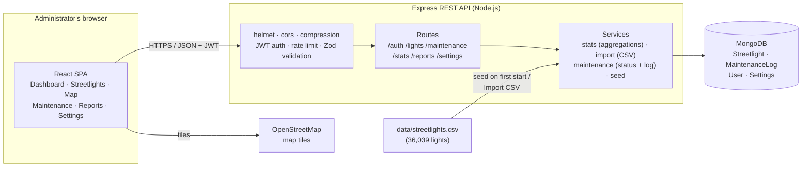
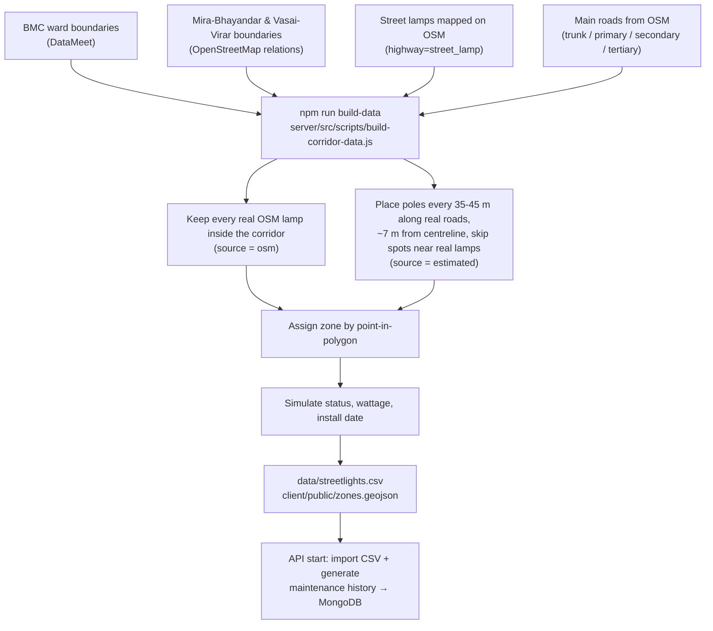
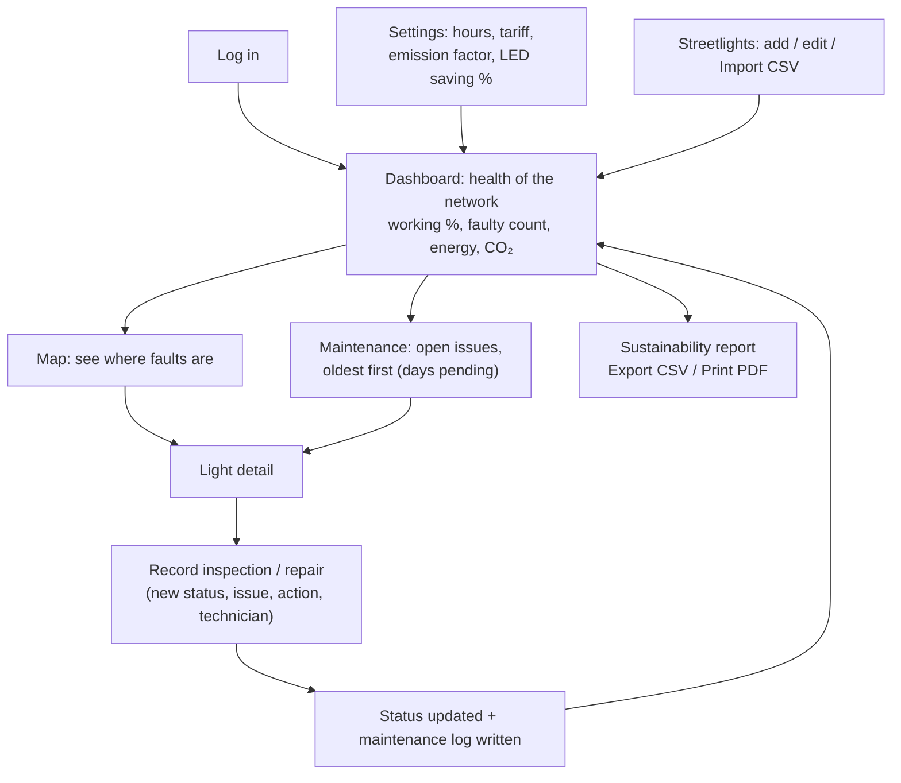
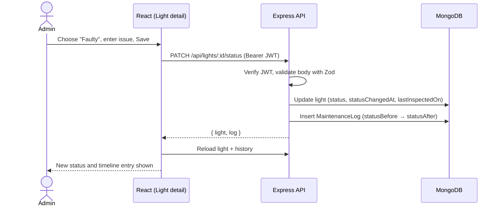

# StreetLight Monitor

**A web-based streetlight monitoring system for sustainable energy management, covering the Western Railway corridor from Churchgate to Virar (Mumbai Metropolitan Region).**

IDEA Lab-V project · Department of Computer Engineering, SLRTCE · Academic Year 2026-27 · Theme: *Urban System*

StreetLight Monitor gives a municipal administrator one place to see every streetlight, find faulty ones, track repairs, and estimate electricity use, cost and CO₂ emissions. It needs no sensors or IoT hardware: it is a software-only dashboard built on real geographic data.

---

## Contents
- [Features](#features)
- [Tech stack](#tech-stack)
- [How the system works](#how-the-system-works)
- [System workflow](#system-workflow)
- [Dataset](#dataset)
- [Energy, cost and CO₂ calculations](#energy-cost-and-co2-calculations)
- [Data model](#data-model)
- [REST API](#rest-api)
- [Project structure](#project-structure)
- [Getting started](#getting-started)
- [Deployment](#deployment)
- [Limitations and future scope](#limitations-and-future-scope)
- [Documentation and credits](#documentation-and-credits)

---

## Features

| Page | What it does |
|---|---|
| **Dashboard** | Total / working / faulty / under-maintenance counts, working rate, monthly energy (kWh), cost (₹), CO₂, possible LED savings, status charts by zone, longest-pending repairs, recent activity |
| **Streetlights** | Search by ID, ward or street; filter by zone, status and data source; paginated table; add / edit / delete; bulk **CSV import** with row-level error report |
| **Light detail** | All attributes, mini-map, link to the OpenStreetMap record, form to record an inspection or repair, full maintenance history timeline |
| **Map** | All ~36,000 lights on one fast canvas layer, coloured by status; real OSM-mapped lamps ringed; ward and municipal boundaries; filter by zone / status / source; click a pole for details |
| **Maintenance** | Open issues sorted by days pending (overdue > 7 days in red), filterable maintenance log, "Log maintenance" form |
| **Sustainability report** | Per-zone and per-lamp-type breakdown of energy, cost and CO₂; LED upgrade opportunity; repairs in the last 30 days; **Export CSV** and **Print / Save as PDF** |
| **Settings** | Operating hours, electricity tariff, grid emission factor and LED saving %, used by every calculation |

Every status change is written to a maintenance log, so each light has a complete history.

---

## Tech stack

| Layer | Technology | Why |
|---|---|---|
| Frontend | **React 18** + **Vite 6**, React Router 6 | Component-based UI, fast dev server and build |
| Styling | **Tailwind CSS 4** | Consistent, responsive design without custom CSS files |
| Charts | **Chart.js 4** via react-chartjs-2 | Doughnut and bar charts for status and energy |
| Maps | **Leaflet 1.9** via react-leaflet 4, **OpenStreetMap** tiles | Free, no API key; canvas renderer handles 36k points |
| HTTP client | **Axios** | JWT header injection, central 401 handling |
| Backend | **Node.js 20+** + **Express 5** | REST API in JavaScript; Express 5 forwards async errors |
| Database | **MongoDB** (Atlas in production) + **Mongoose 8** | Flexible documents, aggregation pipelines for statistics |
| Dev database | **mongodb-memory-server** | Runs without any database setup; auto-seeded on start |
| Auth | **JWT** (jsonwebtoken) + **bcryptjs** | Stateless admin login, hashed passwords |
| Validation | **Zod** | Schema validation on every write route and CSV row |
| Security | **helmet**, **cors**, **express-rate-limit**, **compression** | Secure headers, origin restriction, login throttling, gzip |
| File upload / CSV | **multer**, **csv-parse** | Bulk import of streetlight records |
| Tooling | concurrently, VS Code, Git, GitHub | One command runs API and web app together |
| Hosting | **Render** (one free web service: API + web app); in-memory MongoDB for the demo or **MongoDB Atlas** for persistence | Free; one URL |

---

## How the system works



1. The administrator logs in; the API returns a **JWT** that the frontend sends with every request.
2. Pages request data from the **REST API**. Each request passes security middleware and **Zod** validation.
3. **Services** query MongoDB. Statistics (counts per zone, energy per lamp type) are computed with **MongoDB aggregation pipelines**, so the server never loads all 36k documents into memory.
4. The **map** uses a compact endpoint (`/lights/map`) that returns only `[id, lightId, lat, lng, status, source]` per light (≈ 0.5 MB gzipped) and draws everything on a single **Leaflet canvas** layer. Details for a pole are fetched only when it is clicked.
5. Changing a light's status goes through one service that **updates the light and writes a maintenance log entry** together, so history is never lost.
6. On first start with an empty database, the API **seeds** the admin account, default settings and the 36,039-light dataset, and generates a realistic maintenance history.

---

## System workflow

### 1. Data pipeline (how the dataset is built)



### 2. Administrator workflow



### 3. Request lifecycle: updating a light's status



---

## Dataset

### Coverage: Western Railway corridor, Churchgate → Virar (south to north)

| Zone | Governing body | Lights |
|---|---|---:|
| A · Colaba (Churchgate) | BMC | 1,614 |
| C · Marine Lines | BMC | 435 |
| D · Grant Road | BMC | 1,527 |
| G/S · Worli | BMC | 1,488 |
| G/N · Dadar | BMC | 1,610 |
| H/W · Bandra West | BMC | 1,424 |
| K/W · Andheri West | BMC | 3,225 |
| P/S · Goregaon | BMC | 2,336 |
| P/N · Malad | BMC | 2,100 |
| R/S · Kandivali | BMC | 1,788 |
| R/C · Borivali | BMC | 2,663 |
| R/N · Dahisar | BMC | 1,339 |
| MBMC · Mira-Bhayandar | Mira-Bhayandar Municipal Corporation | 3,084 |
| VVMC · Vasai-Virar | Vasai-Virar City Municipal Corporation | 11,406 |
| **Total** | | **36,039** |

### What is real and what is simulated

No municipal body (BMC, MBMC, VVMC) or electricity utility (BEST, Adani Electricity, MSEDCL) publishes an inventory of individual streetlights. The dataset therefore combines real geography with clearly labelled simulated attributes:

| Field | Status | Source |
|---|---|---|
| Zone boundaries | **Real** | BMC wards: DataMeet *Municipal_Spatial_Data*; MBMC / VVMC limits: OpenStreetMap relations 13180677, 13253971 |
| Position, 68 lights (`source = osm`) | **Real** | Street lamps mapped on OpenStreetMap |
| Position, 35,971 lights (`source = estimated`) | **Real road, estimated pole** | Placed every 35 m (trunk / primary), 40 m (secondary), 45 m (tertiary) along 1,465 km of real OSM main roads |
| Street name | **Real** | OSM `name` / `ref` tags |
| `osmId` | **Real** | Links each light to its OSM node (lamp) or way (road) |
| Lamp type | Real where tagged on OSM, otherwise simulated (95% LED, matching BMC's reported ~97% LED conversion) | |
| Wattage | **Simulated** by road class (trunk 150–200 W … tertiary 70–90 W) | |
| Status, install date, maintenance history | **Simulated** (86% working, 8% faulty, 6% under maintenance) | |

The app states this on the dashboard, report, map and each light's page. If official per-light records are obtained (for example through an RTI request), they can be loaded with **Import CSV** and are marked `source = official`.

**Published figures for context** (see [`docs/corridor-data-sources.md`](docs/corridor-data-sources.md) for citations): BMC converted **84,754** suburban streetlights to LED (~97%, around 2022); BEST controls about **41,000** island-city streetlights through 462 lighting pillars (around 2020).

Full field definitions, source queries, licences and rebuild instructions: [`data/README.md`](data/README.md).

---

## Energy, cost and CO₂ calculations

Only lights with status **Working** are counted as drawing power.

```
daily kWh      = wattage × operating hours per day ÷ 1000
monthly kWh    = daily kWh × 30
monthly cost   = monthly kWh × tariff (₹/kWh)
monthly CO₂    = monthly kWh × grid emission factor (kg CO₂/kWh)
LED saving     = monthly kWh of non-LED lamps × LED saving %
working rate   = working lights ÷ total lights × 100
```

Defaults (editable on the Settings page): 12 h/day, ₹7/kWh, 0.71 kg CO₂/kWh (approximate India grid average; check the latest CEA figure), 50% LED saving.

---

## Data model

| Collection | Key fields |
|---|---|
| **Streetlight** | `lightId` (unique, e.g. `BMC-KW-00001`), `area` (zone), `street`, `location {lat, lng}`, `wattage`, `lampType` (LED / Sodium / CFL / Metal Halide), `status` (working / faulty / under_maintenance), `statusChangedAt`, `installedOn`, `lastInspectedOn`, `source` (osm / estimated / official / manual), `osmId` |
| **MaintenanceLog** | `light` → Streetlight, `date`, `issue`, `action`, `statusBefore`, `statusAfter`, `performedBy`, `notes` |
| **User** | `name`, `email`, `passwordHash` (bcrypt), `role` (admin) |
| **Settings** | `operatingHoursPerDay`, `tariffPerKwh`, `co2KgPerKwh`, `ledSavingPercent` (single document) |

---

## REST API

Base path `/api`. Every route except `POST /auth/login` and `GET /health` requires `Authorization: Bearer <token>`.

| Method | Endpoint | Purpose |
|---|---|---|
| POST | `/auth/login` | Log in, returns JWT |
| GET | `/auth/me` | Current admin |
| GET | `/lights` | List; `area`, `status`, `source`, `search`, `sort`, `page`, `limit` |
| GET | `/lights/map` | Compact rows for the map |
| GET | `/lights/areas` | Zone names, south to north |
| POST | `/lights` | Create a light |
| GET / PUT / DELETE | `/lights/:id` | Read / update (not status) / delete |
| PATCH | `/lights/:id/status` | Change status and write a maintenance log |
| GET | `/lights/:id/maintenance` | History of one light |
| POST | `/lights/import` | Bulk CSV import (multipart field `file`), upsert by `lightId` |
| GET | `/maintenance` | Log; `from`, `to`, `area`, `status`, `limit` |
| GET | `/maintenance/open` | Non-working lights, oldest first, with `daysPending` and `total` |
| POST | `/maintenance` | Add a log entry by `lightId` (optionally changes status) |
| GET | `/stats/summary` | Counts and working % overall, per zone and per source |
| GET | `/stats/energy` | kWh, cost, CO₂ and LED savings per zone and lamp type |
| GET | `/reports/sustainability` | Combined report; `?format=csv` downloads CSV |
| GET / PUT | `/settings` | Read / update calculation assumptions |

More detail: [`architecture.md`](architecture.md).

---

## Project structure

```
streetlight-monitor/
├── client/                         React + Vite web app
│   ├── public/zones.geojson        Ward / municipal outlines for the map
│   └── src/
│       ├── api/client.js           Axios instance, JWT, 401 handling, downloads
│       ├── components/             Layout, cards/badges, Modal, forms, DataNote, ErrorBoundary
│       ├── context/AuthContext.jsx Login state
│       ├── hooks/useFetch.js       Data loading + debounce
│       ├── pages/                  Dashboard, Lights, LightDetail, MapView, Maintenance, Reports, Settings, Login
│       └── utils/                  Formatting, status/source labels, Chart.js setup
├── server/                         Express API
│   └── src/
│       ├── config/                 env.js, db.js (in-memory MongoDB fallback)
│       ├── models/                 Streetlight, MaintenanceLog, User, Settings
│       ├── routes/                 auth, lights, maintenance, stats, reports, settings
│       ├── services/               stats, import, maintenance, seed
│       ├── middleware/             JWT auth, central error handler
│       ├── validation.js           Zod schemas
│       └── scripts/                build-corridor-data.js, seed.js
├── data/
│   ├── streetlights.csv            36,039 lights (generated)
│   ├── sources/                    Raw BMC ward + OpenStreetMap downloads
│   └── README.md                   Dataset documentation
├── docs/corridor-data-sources.md   Published figures and citations for the presentation
├── goal.md · plan.md · architecture.md
└── package.json                    Root scripts (install:all, dev, build, seed)
```

---

## Getting started

**Requirements:** Node.js 20 or newer, Git.

```bash
git clone <this-repo-url>
cd streetlight-monitor
npm run install:all     # installs root, server and client packages
npm run dev             # API on http://localhost:5000, web app on http://localhost:5173
```

Open **http://localhost:5173** and log in with the development account `admin@streetlight.local` / `admin123`.

**No database setup is needed for development.** When `MONGODB_URI` is empty, the API starts a temporary in-memory MongoDB and loads the full dataset on every start (about 15 seconds; changes are lost on restart). The first run downloads a MongoDB binary once, which is large.

### Persistent data with MongoDB Atlas
1. Create a free M0 cluster at mongodb.com/atlas and copy its connection string.
2. `cp server/.env.example server/.env`, then set `MONGODB_URI`, `JWT_SECRET`, `ADMIN_EMAIL` and `ADMIN_PASSWORD`.
3. `npm run dev`: the empty database is seeded automatically on first start. `npm run seed -- --reset` wipes and reseeds it.

### Scripts

| Where | Command | What it does |
|---|---|---|
| root | `npm run dev` | Run API and web app together |
| root | `npm run build` | Production build of the web app |
| server | `npm run build-data` | Rebuild `data/streetlights.csv` and `client/public/zones.geojson` from `data/sources/` |
| server | `npm run seed` | Seed an Atlas database if empty (`-- --reset` to wipe first) |

---

## Deployment

The app deploys as **one free Render web service**: Express serves the API under `/api` and the built React app for every other path.

1. **Render:** *New → Blueprint* → select this repository. [`render.yaml`](render.yaml) configures everything; Render only asks for `ADMIN_PASSWORD` (the live-site login; email `admin@streetlight.local`) and generates `JWT_SECRET`.
2. The site is live at `https://<service>.onrender.com` once the build finishes and the dataset has loaded.

**Database modes**

| Mode | How | Data |
|---|---|---|
| **Demo (default)** | `IN_MEMORY_DB=true`: the service runs its own temporary MongoDB and loads all 36,039 lights on every start | No external database or account needed; edits are lost on restart or when the free instance sleeps |
| **Persistent** | Add `MONGODB_URI` (free **MongoDB Atlas** M0 cluster, network access `0.0.0.0/0`) in the service's *Environment* settings; it takes precedence | Edits are kept; seeded once on first start |

The start command caps Node's heap at 128 MB so Node plus the in-memory MongoDB (≈ 380 MB measured) fit the free tier's 512 MB.

| Setting | Value |
|---|---|
| Build command | `npm --prefix server install && npm --prefix client install --include=dev && npm --prefix client run build` |
| Start command | `npm --prefix server start` |
| Health check | `/api/health` |

Render's free tier sleeps after ~15 minutes idle and takes about a minute to wake: open the site a minute before a demo.

(The web app can also be hosted separately, e.g. on Vercel with `VITE_API_URL` pointing at the API; `client/vercel.json` handles SPA routing.)

---

## Limitations and future scope

**Limitations**
- Pole positions other than the 68 OSM-mapped lamps are estimated along main roads; lanes and residential streets are not included.
- Status, wattage and maintenance history are simulated until official records are available.
- Single administrator role.

**Future scope**
- Import official inventories from BMC, MBMC and VVMC (e.g. via RTI) through the existing CSV import.
- Failure-rate prediction from maintenance history.
- SMS / email alerts for long-pending repairs.
- Field-staff role with a mobile-friendly status update screen.
- Optional integration with smart-meter or IoT data where available.

---

## Documentation and credits

- [`goal.md`](goal.md): problem, objectives, scope, success criteria
- [`architecture.md`](architecture.md): detailed architecture, data model and API
- [`plan.md`](plan.md): phased build plan and progress
- [`data/README.md`](data/README.md): dataset details, sources and licences
- [`docs/corridor-data-sources.md`](docs/corridor-data-sources.md): published figures and citations

**Data credits:** map data and street geometry © [OpenStreetMap](https://www.openstreetmap.org/copyright) contributors (ODbL). BMC ward boundaries from [DataMeet Municipal_Spatial_Data](https://github.com/datameet/Municipal_Spatial_Data).

**Author:** Raj Maurya (Roll No. 10), Department of Computer Engineering, SLRTCE.
